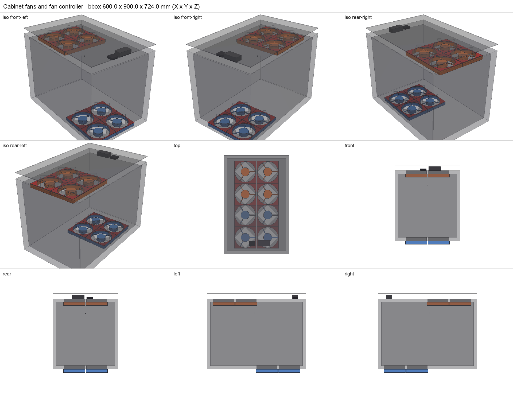

# Rack cooling: cabinet fans and fan controller

Eight 200 mm Noctua NF-A20 PWM fans move air through the SysRacks SP 12.900 acoustic cabinet: four intake under the floor at the front, four exhaust in place of the stock roof fans at the rear. An Aqua Computer QUADRO sets their speed from the exhaust air temperature, on curves stored in the controller. It runs on its own supply with no network, so cooling doesn't depend on any computer, or the switch, being on.

**Status: design.** Nothing is bought or built. Fan positions follow the cabinet's outer drawing; its interior is not measured. Airflow and heat removal are estimates from free-air ratings (about 173 CFM, about 1.5 kW at a 15 °C rise), not measurements.



## Parts

| Part | Qty | Role |
| --- | --- | --- |
| [Noctua NF-A20 PWM](parts/noctua-nf-a20-pwm.md) | 8 | Two 2 × 2 banks, intake and exhaust |
| [Noctua NA-FG1-20](parts/noctua-na-fg1-20.md) | 8 | Steel wire guard on each fan's open side (two Sx5 sets or four Sx2 sets) |
| [DEMCiflex 200 mm round filter](parts/demciflex-200mm-round.md) | 4 | Candidate: dust filter on each intake fan's guard, under the floor |
| [2 mm silicone foam gasket sheet](parts/silicone-gasket-2mm.md) | 8 | Seal between each fan frame and its panel, rotor opening cut out |
| [U-channel edge trim](parts/u-channel-edge-trim.md) | about 5 m | Covers the cut edge of the eight openings; grip range once the steel is measured |
| [Fasteners](parts/fasteners.md) | 32 + spares | Fan-to-panel screws; size and length once the steel and fan hole are measured |
| [Aqua Computer QUADRO](parts/aquacomputer-quadro.md) | 1 | Fan controller: one output per bank, curves on the exhaust temperature |
| [Aqua Computer temperature sensor 70 cm](parts/aquacomputer-temperature-sensor-70cm.md) | 1 | Exhaust air temperature; included with the QUADRO |
| [Noctua 4-pin Y-cable](parts/noctua-4pin-y-cable.md) | 6 | Three per bank to fan each output out to four fans; included with the fans |
| [Generic 12 V + 5 V Molex adapter](parts/generic-12v-5v-molex-adapter.md) | 1 | Candidate: powers the QUADRO and the fans; at least 12 V 1.5 A and 5 V 1.5 A |
| [Fan and sensor cabling](parts/rack-fan-harness.md) | 1 | One 4-pin extension to the floor bank, and a USB header adapter for setup |
| [UniFi Pro Max 16](parts/ubiquiti-usw-pro-max-16.md) | 1 | Rack switch: AIPC onboard 2.5GbE and BMC, 10G SFP+ uplink to the home network |
| [UACC-Pro-Max-16-RM](parts/ubiquiti-uacc-pro-max-16-rm.md) | 1 | 1U rack kit for the half-width switch |
| [SysRacks SP 12.900](parts/rack-cabinet.md) | 1 | 11U acoustic cabinet, 600 × 900 mm; takes eight cutouts (four in the inner top, four in the floor) |

## Docs

- [docs/design.md](docs/design.md): airflow and heat budget, cutout pattern, control strategy, open items
- [docs/wiring.md](docs/wiring.md): connections, one-time setup and curves, failure behaviour
- [docs/system-check.md](docs/system-check.md): generated compatibility report

## Build

```bash
make all BUILD=rack
```

The QUADRO's curves are set once in aquasuite; see [docs/wiring.md](docs/wiring.md#setup-once).
