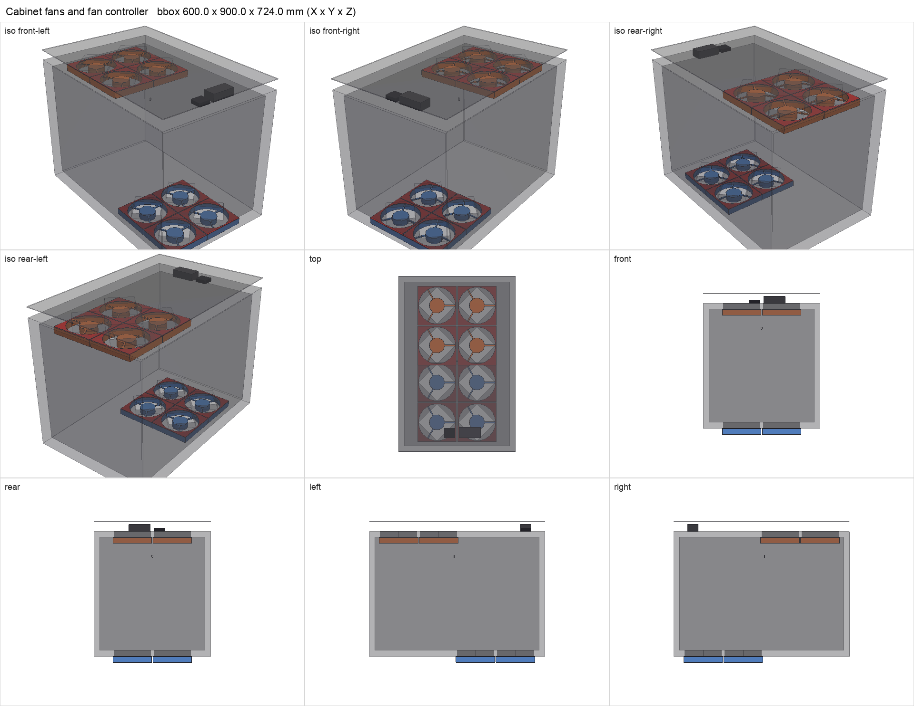

# Rack cooling design notes

## Goal

Move more air through the [SysRacks SP 12.900](../parts/rack-cabinet.md) acoustic cabinet while keeping its noise reduction. The approach is large, slow fans on the cabinet's own air path: in through the floor, out through the roof under the lid. An Aqua Computer QUADRO sets the fan speed from the exhaust temperature, independently of every computer in the rack.

## Fans

Eight [Noctua NF-A20 PWM](../parts/noctua-nf-a20-pwm.md) fans (200 × 30 mm, 350–800 rpm, 86.46 CFM and 18.1 dB(A) at full speed) in two 2 × 2 banks:

- **Exhaust:** under the inner top toward the rear, in place of the two stock fans. It blows up into the space under the outer lid, which vents around its edge as the stock fans do. That edge gap is the acoustic baffle, so no new opening to the outside is cut.
- **Intake:** hung under the floor toward the front, blowing up through four floor cutouts. The cabinet already draws air in at the bottom, and the floor is out of sight and partly shielded by the casters' gap.
- **Controller and supply:** on the inner top in front of the exhaust bank, under the lid. They stay out of the 11U of rack space.

Each bank is 405 × 405 mm (200 mm frames with 5 mm gaps). Both fit the 600 × 900 mm footprint with room to spare.

The intake and exhaust banks are **in series**: the same air passes through both. Together they give one bank's airflow with roughly twice the pressure to push past the equipment. Their CFM ratings don't add.

## How much heat this removes

From [models/cooling-report.json](../models/cooling-report.json). All values are allowances, not measurements:

| | Value |
| --- | --- |
| One bank, free air | 4 × 86.46 = 345.8 CFM |
| Derate for guards, grilles and equipment in the path | 0.5 (allowance) |
| Estimated cabinet airflow at full speed | **about 173 CFM** |
| Heat removed at a 10 °C intake-to-exhaust rise | about 980 W |
| … at 15 °C | about **1,470 W** |
| … at 20 °C | about 1,970 W |

Heat removed in W ≈ CFM × rise in °C ÷ 1.76.

Compared with the builds:

- **AIPC** (about 1.3 kW in [aipc/docs/design.md](../../aipc/docs/design.md)) fits at a rise of about 13 °C.
- **gpulab's** 2.4 kW PSU budget needs about a 24 °C rise, too warm for GPU intakes.
- **Both builds together** (about 3.7 kW) need roughly twice the fans, or a high-pressure duct fan on the GPU exhaust.

The heat load is generic for now ([system.toml](../system.toml) leaves it blank), so `make check` reports the heat budget as BLOCKED until a load is set.

**Measure it.** Once installed, read the intake and exhaust air temperatures at a known load and full fan speed (the QUADRO's sensor in aquasuite for the exhaust, any thermometer at the intake). The real airflow is CFM ≈ 1.76 × W ÷ rise. Replace the 0.5 derate in the fan spec with the measured value.

## Fan bank cutouts

Each fan gets its own round cutout and four screw holes on the 154 mm pattern: four in the inner top and four in the floor. Coordinates are in mm from the bank centre: u across (to the right, seen from the front) and v toward the rear.

| Bank | Panel | Bank centre |
| --- | --- | --- |
| Exhaust | Inner top, under the lid | On the centre line, 647.5 mm behind the outer front face (20 mm from the rear wall) |
| Intake | Floor | On the centre line, 252.5 mm behind the outer front face (20 mm from the front wall) |

These depths assume 30 mm walls. Measure the walls and re-centre each bank before cutting.

| Fan | Centre | Screw holes |
| --- | --- | --- |
| 1 | (−102.5, 102.5) | (−179.5, 179.5), (−25.5, 179.5), (−179.5, 25.5), (−25.5, 25.5) |
| 2 | (102.5, 102.5) | (25.5, 179.5), (179.5, 179.5), (25.5, 25.5), (179.5, 25.5) |
| 3 | (−102.5, −102.5) | (−179.5, −25.5), (−25.5, −25.5), (−179.5, −179.5), (−25.5, −179.5) |
| 4 | (102.5, −102.5) | (25.5, −25.5), (179.5, −25.5), (25.5, −179.5), (179.5, −179.5) |

Before cutting:

- Noctua doesn't publish the bore diameter or the screw-hole size. Measure the fan you bought, cut the round opening to the bore (not larger than the frame), and drill the screw holes to suit the fan screws you choose.
- Measure the bare steel of the inner top and the floor (`panel_sheet_thickness` in the [cabinet spec](../../parts/purchased/rack-cabinet/part.toml), unknown). It decides the cutting tool (a nibbler stops at about 1.6 mm), the edge trim's grip range and the screw length.
- Cut the foam lining back to each cutout and seal its edge, so loose foam can't reach a rotor. Under the inner top, cut it back to the whole fan footprint, so the gasket and frame sit on bare steel instead of compressing foam. Leave the rest of the lining in place: it is the soundproofing.
- Plan the floor cutouts around the foam cable entry and the casters' mounting plates.
- Leave at least 50 mm of clear air on both sides of each bank (a quarter of the fan diameter). Fans pressed against the ceiling, a door or equipment lose most of their airflow.

## Fan mounting stack

Each fan mounts the same way in both banks, from the panel outward:

1. **Panel steel** with the round opening, its edge covered with [U-channel edge trim](../parts/u-channel-edge-trim.md).
2. **[Gasket](../parts/silicone-gasket-2mm.md):** a 200 × 200 mm, 2 mm silicone foam sheet with the rotor opening cut out. It seals the frame to the panel and stops frame buzz on the steel. The CAD models it, and both banks sit 2 mm further from their panels.
3. **Fan,** held by four screws through the panel and gasket into the frame's corner holes on the panel side ([fasteners](../parts/fasteners.md)). Length = steel + 2 mm + engagement in the frame. Size to the fan's hole.
4. **[Noctua NA-FG1-20](../parts/noctua-na-fg1-20.md) wire guard** on the open face, with its own screws, or with its push-pins for a 5 mm offset. On the intake bank that is the underside; on the exhaust bank it is the cabin side, where it keeps cables out of the rotors.
5. **Intake only: [DEMCiflex 200 mm round filter](../parts/demciflex-200mm-round.md)** (candidate) on the steel guard, so it pulls off from below for cleaning. DEMCiflex filters are magnetic, but the round 200 mm listings don't say so. Check that it holds on the round wires before relying on it; otherwise clamp the mesh between the fan and the guard.

The guard's outer size, wire depth and hole pattern, and the filter's thickness, aren't published, so neither is in the CAD yet. Both add to the intake stack under the floor (see [Fit in this cabinet](#fit-in-this-cabinet)). The filter also adds pressure drop on top of the 0.5 derate: measure the airflow with the filters fitted.

### Where to buy

| Part | Buy | Notes |
| --- | --- | --- |
| Noctua NA-FG1-20 | Noctua's store, Amazon, Newegg | Two Sx5 sets (10 guards, list EUR 29.90 each) or four Sx2 sets (exactly 8, list EUR 19.90 each) |
| DEMCiflex 200 mm round | DEMCiflex's store, Amazon, PC retailers | 4 needed. The square 200 mm model is discontinued at several retailers |
| 2 mm silicone foam sheet | McMaster-Carr, Amazon | 8 pieces of at least 200 × 200 mm, or one larger sheet cut to size |
| U-channel edge trim | McMaster-Carr, Amazon, auto parts stores | About 5 m. Choose the grip range after measuring the steel |
| Fan screws | McMaster-Carr, Bolt Depot, hardware store | 32 plus spares, after measuring the steel and the fan hole |

## Controller

Hardware and setup: [wiring.md](wiring.md).

- **Controller:** an [Aqua Computer QUADRO](../parts/aquacomputer-quadro.md), chosen 2026-11-27. It runs its fan curves on its own once configured, with no network, no firmware to maintain and no hand-built board. It replaced an ESP32 design (ESPHome, a hand-wired carrier board, per-fan stall alarms and Ethernet monitoring) because the owner wants simple temperature-based control and doesn't need alarms or monitoring.
- **Two outputs, one per bank.** Output 1 drives the exhaust bank and output 2 the intake bank, four fans each through three chained Y-cables (the ones in the fan boxes). Four NF-A20s draw 0.32 A, against 2 A per output.
- **One sensor.** Both curves follow the exhaust temperature from the sensor included with the QUADRO. A curve on the intake-to-exhaust rise would need aquasuite running on a PC, so it is dropped; the exhaust temperature alone tracks the load.
- **Curves** (16 points each, set in aquasuite, stored in the QUADRO):
  - Exhaust (output 1): 25% at 30 °C or below, rising to 100% at 38 °C.
  - Intake (output 2): the same curve 5 points higher (30% to 100%), to keep slight positive pressure so dust comes in only through the filtered intake.
  - "Minimum power" 25% with "Hold minimum power" on, so the fans never stop. The NF-A20 never drops below about 310 rpm anyway.
  - Full speed at 38 °C, not 42 °C as before, because the QUADRO is rated to 40 °C ambient and sits in exhaust air under the lid.
- **Supply:** a generic 12 V + 5 V adapter with a 4-pin Molex plug (the owner chose generic over a Mean Well GP50A13D). About 7.7 W of fans on 12 V and the QUADRO on 5 V; buy one rated at least 12 V 1.5 A and 5 V 1.5 A.
- **Given up:** stall alarms (one fan per bank reports rpm through the Y-cables, and nothing watches it), monitoring and remote changes. Changing a curve means plugging in the setup laptop.

## Fit in this cabinet

From the SysRacks drawing, with assumed wall and lid values; see [models/cooling-report.json](../models/cooling-report.json):

| Check | Value | Wanted | Status |
| --- | --- | --- | --- |
| Free air under the intake bank (79.5 mm floor clearance on casters, minus 2 mm gasket and 30 mm fan) | 47.5 mm, before the guard and filter | 50 mm (a quarter of the fan diameter) | Short. The guard (5 mm offset plus its unpublished wire depth) and the filter take more, likely leaving under 35 mm. Taller casters or a 30-40 mm plinth fixes it, and helps on carpet |
| Free air above the exhaust bank, under the lid | 47 mm (50 mm lid assumed, minus a 3 mm sheet) | 50 mm | Short on the assumed lid. Measure it; spacers under the lid add room and keep the edge baffle |
| Stock thermostat and fans | Removed | — | The QUADRO replaces them. Keep the stock panel's probe as a spare, or leave the panel as a display only |

## Network switch

A [UniFi Pro Max 16](../parts/ubiquiti-usw-pro-max-16.md) in its 1U [UACC-Pro-Max-16-RM](../parts/ubiquiti-uacc-pro-max-16-rm.md) kit joins the rack to the owner's home UniFi network (chosen 2026-11-27 from Ubiquiti's store). AIPC takes 6U of the 11U of rail (owner), which leaves room for it.

- **Ports:** 4 x 2.5GbE for Berserk's two I226-V ports and Kenshin's onboard port (one spare), 12 x 1GbE for Berserk's BMC and anything slower, 2 x 10G SFP+ for the uplink. The 50GbE Berserk-Kenshin link stays a direct QSFP28 DAC.
- **Noise and heat:** 25 W at most (85.3 BTU/hr). Ubiquiti's tech specs don't state the cooling; retailers list it as fanless. Its ambient limit is 40 C, so it belongs near the intake, not in the exhaust air.
- **Power:** an external AC/DC adapter into USB-C (5 V, 5 A). The kit has room for the adapter. It needs one more PDU outlet; the plug type isn't published.
- **Mounting:** on the fixed rails, not the sliding shelf. Leave enough patch-lead slack to unplug the shelf end before sliding it out.
- **Not modeled:** the U position isn't chosen. It must clear the AIPC duct to the inner top.

## Open items

- **Interior unmeasured.** The SysRacks drawing gives the outside only. Measure:
  - the clear depth between the door foams
  - the clear height from the floor foam to the inner top
  - the clear width
  - the wall, floor, inner-top and lid thicknesses
  - the bare steel thickness of the inner top and the floor, where the fans mount
  - the stock fan size and hole pattern

  Record them in the library [rack-cabinet spec](../../parts/purchased/rack-cabinet/part.toml).
- **Switch position:** choose its U so the switch clears the AIPC duct and sits in intake air; confirm on the unit that it has no fan.
- **AIPC may not fit at all.** AIPC needs about 867 mm of clear depth: 20 mm in front of the shelf, plus 711.2 mm of rail spacing, plus 135.7 mm behind the rear rail. The cabinet is 900 mm deep outside, including two foam-lined doors. AIPC's own check shows this as BLOCKED until the depth is measured.
- **The shelf blocks the floor intake.** The Hammond deck (422.7 mm wide) covers most of the 450 mm rail opening, so air from the floor fans has to rise around its edges and its front. Check how the shelf sits over the floor bank before cutting.
- **QUADRO ambient:** it is rated 10–40 °C and sits in the lid plenum, which carries exhaust air. With full speed at 38 °C exhaust that should hold, but measure the plenum air at full load. If it passes about 38 °C, move the QUADRO and adapter into intake air (for example inside the front of the cabinet) and lengthen the exhaust run instead.
- **Sensor failure:** the QUADRO manual doesn't say what the outputs do if the sensor is unplugged or fails. Test it during commissioning by unplugging the sensor with the curves active. If the fans slow down, the safer setting is a higher minimum power.
- **Supply:** the generic adapter is not chosen. Check its Molex pin order with a meter before first connecting it (pin 1 +12 V, pins 2–3 GND, pin 4 +5 V).
- **Sensor placement:** about 60 mm below the front edge of the exhaust bank, in the airstream, not touching metal; its lead runs up through a cable hole or the fan opening's edge to the QUADRO. Confirm it reads the real exhaust air once installed.
- **Mains supply:** the fan adapter needs a PDU outlet (its plug depends on the unit bought), and the switch adapter one more outlet. `ac-power` is BLOCKED because the rack's mains is not specified.
- **Not built:** the QUADRO and adapter mounting, and the cable lengths.
