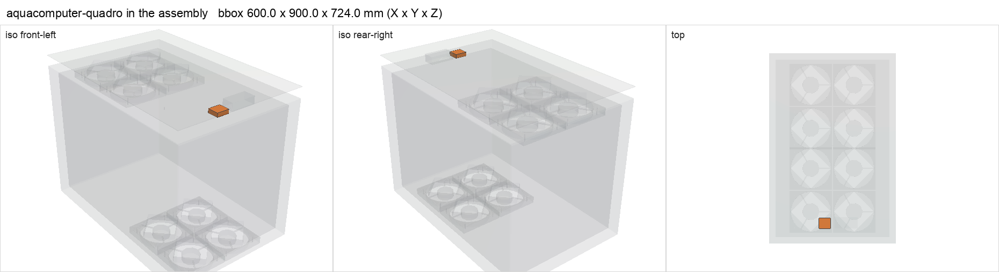

# Aquacomputer QUADRO fan controller (53256)

<!-- Generated by make check from aquacomputer-quadro.toml and the library part.toml. Edit those, not this file. -->

Library spec: [parts/purchased/aquacomputer-quadro](../../parts/purchased/aquacomputer-quadro/README.md) (dimensions, interfaces, datasheets, model).

| | |
| --- | --- |
| Role | fan controller: two outputs, one per bank, both on curves of the exhaust temperature |
| Status | selected |
| Quantity | 1 |
| Systems | rack |

Output 1: exhaust bank (four fans through three Y-cables). Output 2: intake bank,
over one extension to the floor and three Y-cables there. Outputs 3 and 4 spare.
Sensor input 1: exhaust sensor. Set up once from a Windows laptop through a
9-pin-header-to-USB-A adapter, then unplug USB: no USB header in this build.

## Changes for this build

- requires `usb2-header`: removed
- requires `dc-power`: removed
- requires `molex-4pin-power`: sets value 12 V + 5 V, 4-pin Molex (HDD) plug, count 1 — manual 5.2: pin 1 +12 V, pins 2-3 GND, pin 4 +5 V; the fans take their 12 V through the outputs
- requires `dc-5v`: sets load 5, unit W, evidence review — 5 V at 1 A, an Aqua Computer forum estimate for the controller without LEDs, not a manual figure

## Assembly

- 1 instances in the assembly

## Compatibility checks

| Status | Rule | Interface | Detail |
| --- | --- | --- | --- |
| provisional | budget | `dc-5v` | load 5.0 W of 7.5 W x derate 0.8 = 6.0 W (67% of rating) |
| provisional | value | `fan-header-4pin` | noctua-4pin-y-cable needs 12 V 4-pin PWM; provided by aquacomputer-quadro, noctua-4pin-y-cable |
| provisional | value | `fan-header-4pin` | noctua-nf-a20-pwm needs 12 V 4-pin PWM; provided by aquacomputer-quadro, noctua-4pin-y-cable |
| provisional | count | `fan-header-4pin` | need 14 x fan-header-4pin=12 v 4-pin pwm, have 16 |
| provisional | value | `molex-4pin-power` | aquacomputer-quadro needs 12 V + 5 V, 4-pin Molex (HDD) plug; provided by generic-12v-5v-molex-adapter |
| provisional | count | `molex-4pin-power` | need 1 x molex-4pin-power=12 v + 5 v, 4-pin molex (hdd) plug, have 1 |
| pass | value | `aquacomputer-temp-input` | aquacomputer-temperature-sensor-70cm needs Aqua Computer 2-pin temperature sensor; provided by aquacomputer-quadro |
| pass | count | `aquacomputer-temp-input` | need 1 x aquacomputer-temp-input=aqua computer 2-pin temperature sensor, have 4 |

