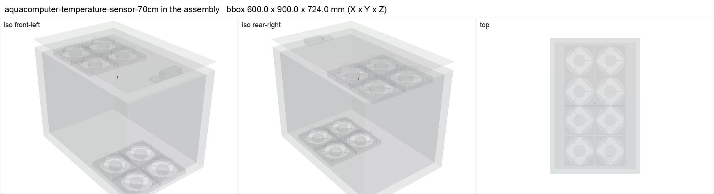

# Aqua Computer temperature sensor 70 cm (art. 53026)

<!-- Generated by make check from aquacomputer-temperature-sensor-70cm.toml and the library part.toml. Edit those, not this file. -->

Library spec: [parts/purchased/aquacomputer-temperature-sensor-70cm](../../parts/purchased/aquacomputer-temperature-sensor-70cm/README.md) (dimensions, interfaces, datasheets, model).

| | |
| --- | --- |
| Role | exhaust air temperature, the input to both fan curves |
| Status | selected |
| Quantity | 1 |
| Systems | rack |

The one included with the QUADRO; nothing extra to buy. In the exhaust airstream about 60 mm before the exhaust bank, not touching metal.

## Assembly

- 1 instances in the assembly

## Compatibility checks

| Status | Rule | Interface | Detail |
| --- | --- | --- | --- |
| pass | value | `aquacomputer-temp-input` | aquacomputer-temperature-sensor-70cm needs Aqua Computer 2-pin temperature sensor; provided by aquacomputer-quadro |
| pass | count | `aquacomputer-temp-input` | need 1 x aquacomputer-temp-input=aqua computer 2-pin temperature sensor, have 4 |

