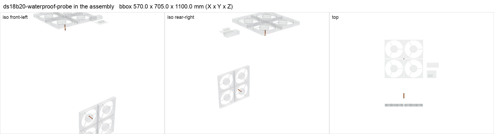

# DS18B20 waterproof probe (stainless tube, 3-wire cable)

<!-- Generated by make check from ds18b20-waterproof-probe.toml and the library part.toml. Edit those, not this file. -->

Library spec: [parts/purchased/ds18b20-waterproof-probe](../../parts/purchased/ds18b20-waterproof-probe/README.md) (dimensions, interfaces, datasheets, model).

| | |
| --- | --- |
| Role | intake and exhaust air temperature probes |
| Status | selected |
| Quantity | 2 |
| Systems | rack |

Intake probe in the intake airstream just inside the intake fans; exhaust probe in the exhaust airstream just before the exhaust fans. Keep both out of direct contact with metal and equipment.

## Assembly

- 2 instances in the assembly

## Compatibility checks

| Status | Rule | Interface | Detail |
| --- | --- | --- | --- |
| provisional | value | `onewire-port` | ds18b20-waterproof-probe needs 3.3 V, DQ, GND; provided by rack-fan-controller-board |
| provisional | count | `onewire-port` | need 2 x onewire-port=3.3 v, dq, gnd, have 2 |

