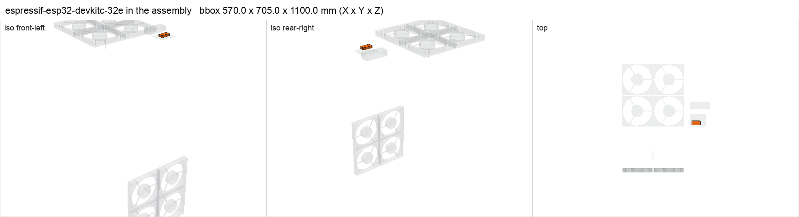

# Espressif ESP32-DevKitC-32E (DevKitC V4, ESP32-WROOM-32E)

<!-- Generated by make check from espressif-esp32-devkitc-32e.toml and the library part.toml. Edit those, not this file. -->

Library spec: [parts/purchased/espressif-esp32-devkitc-32e](../../parts/purchased/espressif-esp32-devkitc-32e/README.md) (dimensions, interfaces, datasheets, model).

| | |
| --- | --- |
| Role | fan controller: reads both probes and all eight tachs, drives the two PWM channels, runs ESPHome |
| Status | selected |
| Quantity | 1 |
| Systems | rack |

## Assembly

- 1 instances in the assembly

## Compatibility checks

| Status | Rule | Interface | Detail |
| --- | --- | --- | --- |
| provisional | count | `devkitc-socket` | need 1 x devkitc-socket, have 1 |
| pass | budget | `dc-5v` | load 2.5 W of 5.0 W x derate 0.8 = 4.0 W (50% of rating) |

