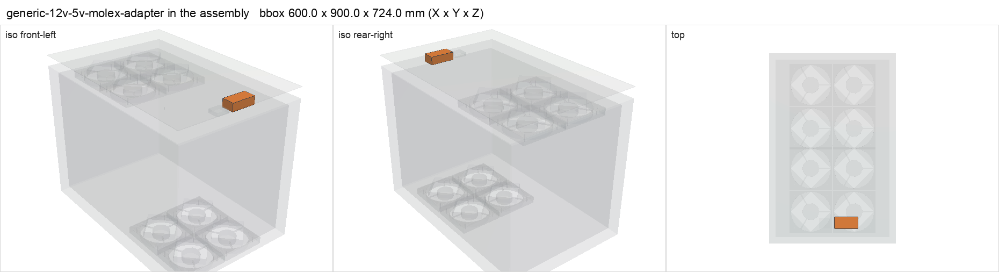

# Generic 12 V + 5 V desktop adapter with a 4-pin Molex plug (not chosen)

<!-- Generated by make check from generic-12v-5v-molex-adapter.toml and the library part.toml. Edit those, not this file. -->

Library spec: [parts/purchased/generic-12v-5v-molex-adapter](../../parts/purchased/generic-12v-5v-molex-adapter/README.md) (dimensions, interfaces, datasheets, model).

| | |
| --- | --- |
| Role | 12 V and 5 V for the QUADRO and, through it, the fans; plugged into the rack PDU |
| Status | candidate |
| Quantity | 1 |
| Systems | rack |

## Assembly

- 1 instances in the assembly

## Compatibility checks

| Status | Rule | Interface | Detail |
| --- | --- | --- | --- |
| BLOCKED | budget | `ac-power` | load 42.0 W; capacity unknown |
| provisional | budget | `dc-12v` | load 7.7 W of 18.0 W x derate 0.8 = 14.4 W (43% of rating) |
| provisional | budget | `dc-5v` | load 5.0 W of 7.5 W x derate 0.8 = 6.0 W (67% of rating) |
| provisional | value | `molex-4pin-power` | aquacomputer-quadro needs 12 V + 5 V, 4-pin Molex (HDD) plug; provided by generic-12v-5v-molex-adapter |
| provisional | count | `molex-4pin-power` | need 1 x molex-4pin-power=12 v + 5 v, 4-pin molex (hdd) plug, have 1 |

