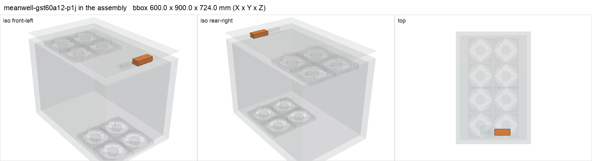

# Mean Well GST60A12-P1J 12 V 5 A desktop adapter

<!-- Generated by make check from meanwell-gst60a12-p1j.toml and the library part.toml. Edit those, not this file. -->

Library spec: [parts/purchased/meanwell-gst60a12-p1j](../../parts/purchased/meanwell-gst60a12-p1j/README.md) (dimensions, interfaces, datasheets, model).

| | |
| --- | --- |
| Role | 12 V supply for the fans and the controller, plugged into the rack PDU |
| Status | selected |
| Quantity | 1 |
| Systems | rack |

## Assembly

- 1 instances in the assembly

## Compatibility checks

| Status | Rule | Interface | Detail |
| --- | --- | --- | --- |
| BLOCKED | budget | `ac-power` | load 92.0 W; capacity unknown |
| provisional | budget | `dc-12v` | load 8.8 W of 60.0 W x derate 0.8 = 48.0 W (15% of rating) |
| provisional | value | `dc-barrel-5.5x2.1` | rack-fan-controller-board needs 12 V, 5.5 x 2.1 mm, centre positive; provided by meanwell-gst60a12-p1j |
| provisional | count | `dc-barrel-5.5x2.1` | need 1 x dc-barrel-5.5x2.1=12 v, 5.5 x 2.1 mm, centre positive, have 1 |

