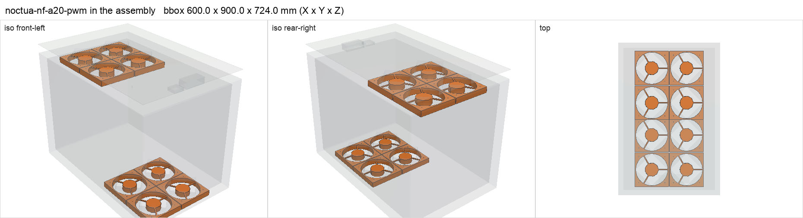

# Noctua NF-A20 PWM 200 x 30 mm fan

<!-- Generated by make check from noctua-nf-a20-pwm.toml and the library part.toml. Edit those, not this file. -->

Library spec: [parts/purchased/noctua-nf-a20-pwm](../../parts/purchased/noctua-nf-a20-pwm/README.md) (dimensions, interfaces, datasheets, model).

| | |
| --- | --- |
| Role | cabinet fans: four intake low at the front, four exhaust at the top rear or roof |
| Status | selected |
| Quantity | 8 |
| Systems | rack |

Exhaust bank on QUADRO fan output 1, intake bank on output 2, four fans per output through three Y-cables. Positions are provisional until the cabinet is measured.

## Assembly

- 8 instances in the assembly

## Compatibility checks

| Status | Rule | Interface | Detail |
| --- | --- | --- | --- |
| BLOCKED | budget | `cabinet-heat-removal` | load 0.0 W of 2947.2 W x derate 0.5 = 1473.6 W (0% of rating); unknown load for ['system'] |
| provisional | value | `cabinet-fan-opening` | noctua-nf-a20-pwm needs 200 mm fan, 154 mm hole pitch; provided by rack-cabinet |
| provisional | count | `cabinet-fan-opening` | need 8 x cabinet-fan-opening=200 mm fan, 154 mm hole pitch, have 8 |
| provisional | budget | `dc-12v` | load 7.7 W of 18.0 W x derate 0.8 = 14.4 W (43% of rating) |
| provisional | value | `fan-header-4pin` | noctua-nf-a20-pwm needs 12 V 4-pin PWM; provided by aquacomputer-quadro, noctua-4pin-y-cable |
| provisional | count | `fan-header-4pin` | need 14 x fan-header-4pin=12 v 4-pin pwm, have 16 |
| pass | value | `fan-guard-mount` | noctua-na-fg1-20 needs 200 mm fan; provided by noctua-nf-a20-pwm |
| pass | count | `fan-guard-mount` | need 8 x fan-guard-mount=200 mm fan, have 8 |

