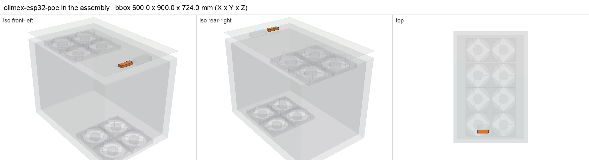

# Olimex ESP32-POE (ESP32-WROOM-32E-N4, 100 Mb Ethernet, hardware revision M2)

<!-- Generated by make check from olimex-esp32-poe.toml and the library part.toml. Edit those, not this file. -->

Library spec: [parts/purchased/olimex-esp32-poe](../../parts/purchased/olimex-esp32-poe/README.md) (dimensions, interfaces, datasheets, model).

| | |
| --- | --- |
| Role | fan controller: reads both probes and all eight tachs, drives the two PWM channels, runs ESPHome on wired Ethernet |
| Status | selected |
| Quantity | 1 |
| Systems | rack |

Order the plain ESP32-POE (WROOM-32E-N4), not -WROVER or -ISO. Powered from the
controller board's 5 V converter through EXT1 pin 1; PoE is not used. Patch lead to
a 1GbE port on the UniFi Pro Max 16 (no PoE on that switch). Wi-Fi off.

## Assembly

- 1 instances in the assembly

## Compatibility checks

| Status | Rule | Interface | Detail |
| --- | --- | --- | --- |
| provisional | value | `olimex-ext-socket` | olimex-esp32-poe needs 2 x 10, 2.54 mm, rows 25.4 mm apart; provided by rack-fan-controller-board |
| provisional | count | `olimex-ext-socket` | need 1 x olimex-ext-socket=2 x 10, 2.54 mm, rows 25.4 mm apart, have 1 |
| pass | budget | `dc-5v` | load 1.0 W of 5.0 W x derate 0.8 = 4.0 W (20% of rating) |
| pass | count | `ethernet-1gbe-rj45` | need 1 x ethernet-1gbe-rj45, have 12 |

