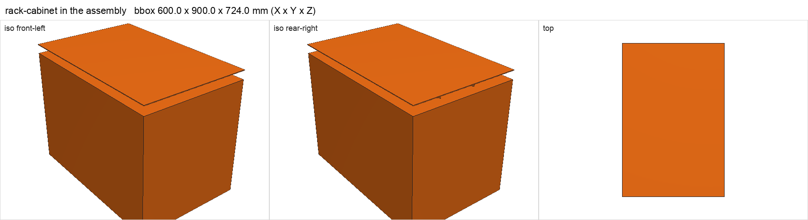

# SysRacks SP 12.900 12U soundproof cabinet (600 x 900)

<!-- Generated by make check from rack-cabinet.toml and the library part.toml. Edit those, not this file. -->

Library spec: [parts/purchased/rack-cabinet](../../parts/purchased/rack-cabinet/README.md) (dimensions, interfaces, datasheets, model).

| | |
| --- | --- |
| Role | acoustic cabinet: exhaust fans replace the stock roof fans, intake fans under the floor, controller and supply under the lid |
| Status | selected |
| Quantity | 1 |
| Systems | rack |

Cutouts: four in the inner top for the exhaust bank and four in the floor for the intake bank, each with four screw holes; positions in docs/design.md. Interior dimensions unmeasured.

## Changes for this build

- provides `cabinet-fan-opening`: sets value 200 mm fan, 154 mm hole pitch, count 8, evidence allowance — a 405 x 405 mm bank fits the inner top and the floor on the 600 x 900 drawing; foam, cable entry and stock fan holes not measured

## Assembly

- 2 instances in the assembly

## Compatibility checks

| Status | Rule | Interface | Detail |
| --- | --- | --- | --- |
| BLOCKED | value | `panel-sheet-edge` | u-channel-edge-trim needs sheet steel cutout edge; provider value unknown |
| provisional | value | `cabinet-fan-opening` | noctua-nf-a20-pwm needs 200 mm fan, 154 mm hole pitch; provided by rack-cabinet |
| provisional | count | `cabinet-fan-opening` | need 8 x cabinet-fan-opening=200 mm fan, 154 mm hole pitch, have 8 |
| provisional | value | `rack-standard` | ubiquiti-uacc-pro-max-16-rm needs EIA-310 19 in; provided by rack-cabinet |
| provisional | count | `rack-units` | need 1 x rack-units, have 11 |

