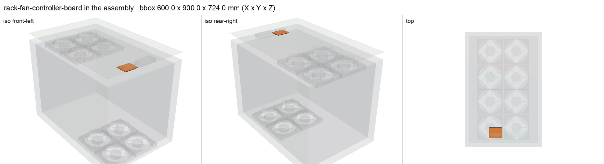

# Rack fan controller board (Olimex ESP32-POE socket, 8 fan headers, 1-Wire)

<!-- Generated by make check from rack-fan-controller-board.toml and the library part.toml. Edit those, not this file. -->

Library spec: [parts/fabricated/rack-fan-controller-board](../../parts/fabricated/rack-fan-controller-board/README.md) (dimensions, interfaces, datasheets, model).

| | |
| --- | --- |
| Role | perfboard: 12 V distribution, 5 V converter, PWM drivers, tach pull-ups, 1-Wire terminal |
| Status | design |
| Quantity | 1 |
| Systems | rack |

## Assembly

- 1 instances in the assembly

## Compatibility checks

| Status | Rule | Interface | Detail |
| --- | --- | --- | --- |
| provisional | budget | `dc-12v` | load 8.8 W of 60.0 W x derate 0.8 = 48.0 W (15% of rating) |
| provisional | value | `dc-barrel-5.5x2.1` | rack-fan-controller-board needs 12 V, 5.5 x 2.1 mm, centre positive; provided by meanwell-gst60a12-p1j |
| provisional | count | `dc-barrel-5.5x2.1` | need 1 x dc-barrel-5.5x2.1=12 v, 5.5 x 2.1 mm, centre positive, have 1 |
| provisional | value | `fan-header-4pin` | noctua-nf-a20-pwm needs 12 V 4-pin PWM; provided by rack-fan-controller-board |
| provisional | count | `fan-header-4pin` | need 8 x fan-header-4pin=12 v 4-pin pwm, have 8 |
| provisional | value | `olimex-ext-socket` | olimex-esp32-poe needs 2 x 10, 2.54 mm, rows 25.4 mm apart; provided by rack-fan-controller-board |
| provisional | count | `olimex-ext-socket` | need 1 x olimex-ext-socket=2 x 10, 2.54 mm, rows 25.4 mm apart, have 1 |
| provisional | value | `onewire-port` | ds18b20-waterproof-probe needs 3.3 V, DQ, GND; provided by rack-fan-controller-board |
| provisional | count | `onewire-port` | need 2 x onewire-port=3.3 v, dq, gnd, have 2 |
| pass | budget | `dc-5v` | load 1.0 W of 5.0 W x derate 0.8 = 4.0 W (20% of rating) |

