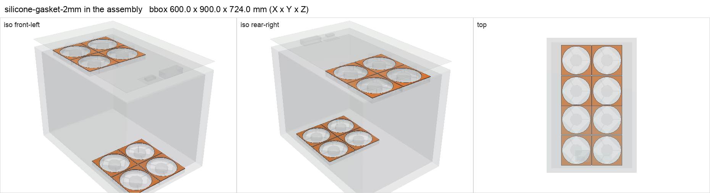

# 2 mm silicone foam gasket sheet, 200 x 200 mm

<!-- Generated by make check from silicone-gasket-2mm.toml and the library part.toml. Edit those, not this file. -->

Library spec: [parts/purchased/silicone-gasket-2mm](../../parts/purchased/silicone-gasket-2mm/README.md) (dimensions, interfaces, datasheets, model).

| | |
| --- | --- |
| Role | seal between each fan frame and its cabinet panel: a 200 x 200 mm sheet with the rotor opening cut out |
| Status | candidate |
| Quantity | 8 |
| Systems | rack |

Stops air leaking around the frame and frame buzz on the steel. Under the inner top, cut the foam lining back to the fan footprint so the gasket sits on bare steel.

## Assembly

- 8 instances in the assembly

